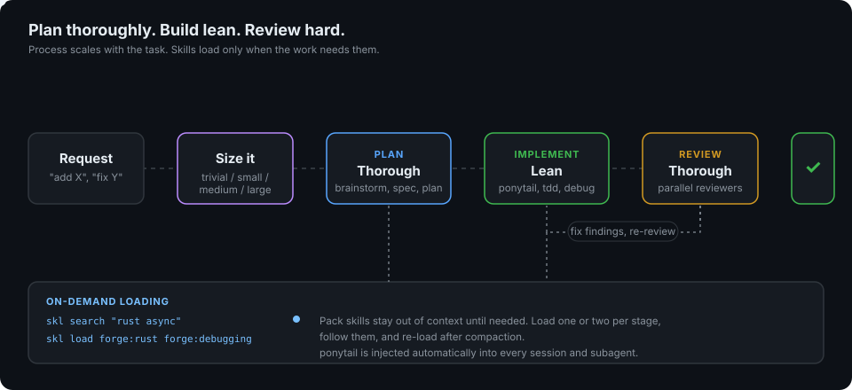

<div align="center">

# skill-packs

**181 skills and 15 agents for Claude Code, in three packs.**
Plan thoroughly. Build lean. Review hard.



</div>

## What you get

| Pack | Skills | Use it for |
|------|:------:|------------|
| [**forge**](docs/forge.md) | 98 | Planning, lean implementation, code review, language stacks (Rust, Go, Python), DevOps generators and validators, research, agent and MCP work |
| [**atrium**](docs/atrium.md) | 42 | Business work: Word/Excel/PowerPoint/PDF, brand and copy, SEO, growth, sales, CRM, finance, strategy, contracts |
| [**atelier**](docs/atelier.md) | 41 | Visual work: web UI, design systems, motion, launch and demo films, images, AI video, logos, Blender and 3D, CAD, diagrams |

Each pack has a router skill (`forge:using-forge`, `atrium:using-atrium`, `atelier:using-atelier`) that says which skill to load for the job at hand.

## Install

```
/plugin marketplace add SpartaTGBU/skill-packs
/plugin install forge@skill-packs
/plugin install atrium@skill-packs
/plugin install atelier@skill-packs
```

Install only the packs you want. atrium and atelier work alone, but the `skl` loader ships with forge, so install forge if you want on-demand loading for all three.

## How it works in 60 seconds

1. **Size the task.** A one-line fix needs no ceremony. A new feature gets the full route.
2. **Plan thoroughly** for medium and large work: brainstorm, spec, plan.
3. **Implement lean.** The `ponytail` skill is injected automatically: smallest complete change, no speculative code.
4. **Review thoroughly.** Dispatch reviewers in parallel, fix verified findings, then verify before saying "done".
5. **Load skills on demand.** Pack skills are hidden from the per-turn skill list so they cost no context until used.

```bash
skl search "database migration"      # rank skills by name and description
skl list atrium                      # every skill in a pack, one line each
skl load forge:database-migrations   # print the skill and follow it
```

Humans can also type a skill directly: `/forge:rust`, `/atrium:seo-audit`, `/atelier:motion-design`.

| Task size | Signals | Route |
|-----------|---------|-------|
| Trivial | One obvious edit, a lookup | Just do it |
| Small | Clear goal, 1-2 files | `ponytail`, then `verification` |
| Medium | Several files, a real design choice | `brainstorming`, `writing-plans`, implement, `code-review` |
| Large | New feature, unclear requirements | `brainstorming`, `writing-specs`, `writing-plans`, `executing-plans`, `code-review`, `verification`, `finishing-branch` |

When unsure between two sizes, plan for the larger and code for the smaller.

## Examples

| You type | Skills that load | Result |
|----------|------------------|--------|
| "Add rate limiting to the API" | `brainstorming`, `writing-plans`, `rust` or `go`, `code-review`, `security-review` | A plan, a minimal change, and parallel reviews before merge |
| "This test is flaky" | `debugging`, `tdd`, `verification` | Root cause found first, a failing test, then the fix |
| "Write a launch page and an SEO plan" | `atrium:using-atrium`, `atrium:seo-audit`, `atelier:frontend-design` | Copy, keyword plan and a built page |
| "Make a 20-second AI video ad" | `atelier:ai-video`, `atelier:video-composition` | A shot list, per-shot prompts and an assembly plan |

Each pack guide has a table with every skill, when it earns its place, and a ready-to-paste example prompt, plus end-to-end walkthroughs.

## Documentation

| Read this | If you are |
|-----------|-----------|
| [docs/how-it-works.md](docs/how-it-works.md) | Learning the model: sizing, phases, `skl`, hooks, agents |
| [docs/forge.md](docs/forge.md), [docs/atrium.md](docs/atrium.md), [docs/atelier.md](docs/atelier.md) | Looking up a skill or following a walkthrough |
| [AGENTS.md](AGENTS.md) | An agent that needs the operating contract in one page |
| [docs/contributing.md](docs/contributing.md) | Adding or changing a skill |

## Repository layout

```
.claude-plugin/marketplace.json   marketplace manifest
plugins/
  forge/    skills/  agents/  hooks/  bin/skl  NOTICE.md
  atrium/   skills/  NOTICE.md
  atelier/  skills/  NOTICE.md
docs/       guides, assets
```

## License and credits

MIT, see [LICENSE](LICENSE). These packs are derivative works. They merge and rewrite ideas from many MIT and Apache-2.0 projects, and each pack's `NOTICE.md` lists every source, commit and license. Thank you to those authors.
