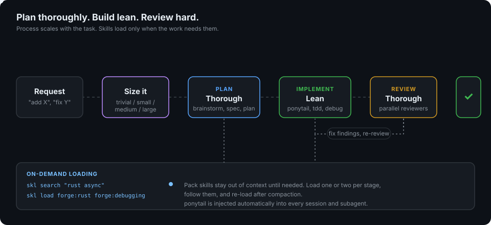

# How it works

## The three phases

| Phase | Posture | Typical skills |
|-------|---------|----------------|
| Plan | Thorough. Ask, research, write down the design. | `brainstorming`, `writing-specs`, `writing-plans`, `architecture`, `research` |
| Implement | Lean (ponytail). Smallest complete change. | `ponytail` (automatic), `tdd`, `debugging`, `executing-plans` |
| Review | Thorough. Independent eyes, verified findings. | `code-review`, `security-review`, `verification`, `finishing-branch` |

The asymmetry is the point. Mistakes are cheapest to fix in the plan and most expensive after merge, so the effort goes there. Code itself stays small because every line is something to review and maintain.

## Sizing

Pick the size before anything else, because it decides how much process to run. Trivial and small tasks skip planning entirely. When two sizes seem plausible, plan for the larger and code for the smaller.

## On-demand loading with `skl`

Claude Code lists every available skill in each turn's context. With 181 skills that would be wasteful, so pack skills are marked `disable-model-invocation: true` and stay out of that list. `skl` fills the gap:

| Command | Does |
|---------|------|
| `skl search <words>` | Ranks skills by name and description match |
| `skl list [pack]` | One line per skill |
| `skl load <name>...` | Prints `SKILL.md` and its directory listing; accepts `forge:rust`, `forge-rust` or `rust` |
| `skl hide` | Marks any skill missing the on-demand marker; run after adding a skill |

Hooks keep this reliable. A `PostToolUse` hook records which skills a session loaded, and a `SessionStart` hook on `compact` reminds the agent which ones to reload.

## Ponytail

`forge:ponytail` is injected into every session and subagent, except in plan mode. It makes implementation follow a ladder: does it need to exist, is it already in the codebase, is it in the standard library, is it an installed dependency, then the minimum new code. It never cuts validation at trust boundaries, security, accessibility, or anything you asked for.

## Reviewer agents

`plugins/forge/agents/` holds 15 agents (reviewers, planners and build fixers): `code-reviewer`, `security-reviewer`, `silent-failure-hunter`, `pr-test-analyzer`, `type-design-analyzer`, `comment-analyzer`, `code-simplifier`, `architect`, `planner`, plus language and build specialists for Rust, Go, Python and databases. They are read-only (except the build resolvers and simplifier) and must return findings with `file:line`, severity and a concrete failure scenario.

## Where each pack fits

- **forge** is the engineering core and the only pack with hooks, agents and the `skl` binary.
- **atrium** and **atelier** are skill-only. They reuse forge's `skl` loader and the same sizing idea: scale discovery to the job.

Per-skill details and example prompts: [forge](forge.md), [atrium](atrium.md), [atelier](atelier.md).
